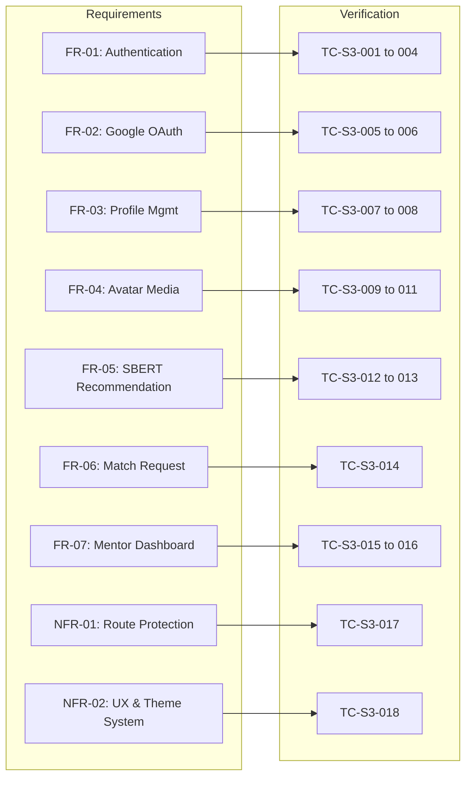

# Sprint 3 — Test Record

## Overview
This document records the verification and validation test results for Sprint 3 of MentorPlug, covering frontend user interface integration, Google OAuth authentication, profile management with image avatar uploads, the end-to-end NLP-based mentor-mentee recommendation flow, mentor request approvals, and role-based route protection.

- **System:** MentorPlug Full-Stack Application (React.js + Vite + Node.js + Express + PostgreSQL + Sentence-BERT NLP + Google Identity Services)
- **Test Environment:** Chrome v131 / Vite Dev Server / Node.js v24 LTS / Postman v11 / Python 3.11 (`all-MiniLM-L6-v2`)
- **Database:** PostgreSQL (`mentorplug`)
- **Date:** October 2026
- **Test Framework / Format:** Aligned with Course Documentation Guidelines (Section 5.4.2 — Table 5.3: Test Cases and Results)
- **Result Summary:** 18 / 18 Passed (100%)

---

## Test Record Table (Table 5.3 Format)

| Test ID | Traceability | Scenario, Data and Conditions | Expected Result | Actual Result, Evidence and Verdict |
| :---: | :--- | :--- | :--- | :--- |
| **TC-S3-001** | `FR-01 / Authentication` | Valid mentee and mentor account registration via `/register` form (Name, Email, Password ≥ 6 chars, Role selection). | Account created with bcrypt hash, JWT returned, saved to `localStorage`, and user redirected to `/profile`. | **Passed** — User registered, token stored, Navbar immediately renders user name, avatar, and navigation links. |
| **TC-S3-002** | `FR-01 / Authentication` | Registration attempt with invalid input (e.g., password mismatch, missing required fields, or already registered email). | Form submission blocked with inline field errors or alert banner indicating duplicate email; no network call for invalid form data. | **Passed** — Client-side validation prevents premature submission; backend 409 Conflict displays clear error banner without crash. |
| **TC-S3-003** | `FR-01 / Authentication` | Valid credential login via `/login` form (Registered email + valid password). | `200 OK` response with JWT and user object; auth state set, user redirected to intended dashboard (`/recommendations` for mentee, `/mentor-dashboard` for mentor). | **Passed** — Authenticated state established, JWT persisted, Navbar updates to authenticated state dynamically. |
| **TC-S3-004** | `FR-01 / Authentication` | Login attempt with invalid credentials (wrong password or unregistered email). | `401 Unauthorized` response safely caught by Axios; error message "Invalid credentials" displayed in red alert banner. | **Passed** — Error handled smoothly without UI freeze; input fields remain populated for user correction. |
| **TC-S3-005** | `FR-02 / Google OAuth` | Google Sign-In with an existing Google-linked account via `GoogleAuthButton`. | Google credential ID token sent to `POST /api/auth/google`; verified by `google-auth-library`; returns signed JWT and redirects to dashboard. | **Passed** — Seamless one-click login; profile name, email, and Google profile picture synchronized. |
| **TC-S3-006** | `FR-02 / Google OAuth` | Google Sign-Up for a new user without an existing account. | Frontend intercepts missing role; prompts modal/radio selector for role ("Mentee" vs "Mentor"); registers account with `googleId` and returns JWT. | **Passed** — Modal role selection enforced before account creation; new account registered successfully with Google identity. |
| **TC-S3-007** | `FR-03 / Profile Management` | Authenticated user visits `/profile` and updates bio, comma-delimited skills, and interests. | Form pre-populates existing data; on submit, `POST /api/profiles` triggers Python SBERT child process, saves 384-dim embedding, returns `201 Created` with success toast. | **Passed** — Profile bio and arrays updated in PostgreSQL; dense embedding vector re-indexed synchronously. |
| **TC-S3-008** | `FR-03 / Profile Management` | Profile update with empty bio or empty skills. | Frontend validates inputs; blocks submission with warning banner "Bio, skills, and interests are required". | **Passed** — Form validation intercepts empty submissions; server-side 400 validation safeguards database integrity. |
| **TC-S3-009** | `FR-04 / Avatar Upload` | User uploads JPEG/PNG profile image (< 5MB) via file input on `/profile`. | Multipart `FormData` sent to `POST /api/profiles/avatar`; Multer stores file under `backend/uploads/avatars/`; updates `avatar_url` in database; displays immediately. | **Passed** — Image saved on disk (`avatar_<accountID>.<ext>`), URL updated in state, image reflected across Profile and Navbar. |
| **TC-S3-010** | `FR-04 / Avatar Upload` | User attempts upload of unsupported file type (e.g. PDF/TXT) or file exceeding 5MB. | Client-side and Multer filters reject file; displays error message "Only JPEG, PNG, WebP, or GIF images are allowed (max 5MB)". | **Passed** — Rejected cleanly before file processing; existing profile avatar remains untouched. |
| **TC-S3-011** | `FR-04 / Avatar Fallback` | User without uploaded photo views Navbar, Recommendations, or Dashboard. | System extracts user initials from account name; renders circular styled badge with initials and contrasting background. | **Passed** — Initials badge displays reliably with correct typography; no broken image icons. |
| **TC-S3-012** | `FR-05 / Recommendation Flow` | Mentee with complete profile visits `/recommendations` and clicks "Find Mentors" / runs match pipeline. | Frontend calls `POST /api/recommendations`; backend executes `nlp/recommend.py`; returns ranked list of mentors with SBERT similarity percentages. | **Passed** — Recommendations generated in ~1.2s; mentors displayed in descending order with score badges (e.g., 80.5% Match) and skill tags. |
| **TC-S3-013** | `FR-05 / Recommendation Flow` | Mentee with empty/incomplete profile visits `/recommendations`. | System alerts user "Please complete your profile before generating recommendations" with direct link button to `/profile`. | **Passed** — Safeguard alert rendered; premature NLP execution prevented. |
| **TC-S3-014** | `FR-06 / Mentorship Request` | Mentee clicks "Request Mentorship" button on a recommended mentor card. | `POST /api/recommendations/:id/request` dispatched; match status set to `"pending"`; button text updates to "Request Sent" (disabled). | **Passed** — Status saved in `matches` table; button enters persistent pending state to eliminate duplicate requests. |
| **TC-S3-015** | `FR-07 / Mentor Dashboard` | Mentor signs in and navigates to `/mentor-dashboard`. | `GET /api/recommendations/incoming` retrieves pending and past mentee requests; cards render mentee name, bio, skills, interests, and compatibility score. | **Passed** — Incoming requests rendered cleanly with actionable "Accept" and "Decline" action buttons. |
| **TC-S3-016** | `FR-07 / Mentor Dashboard` | Mentor clicks "Accept" or "Decline" on an incoming mentee request. | `PATCH /api/recommendations/:id/status` sent with `{ status: "accepted" }` or `"rejected"`; record updated in PostgreSQL; UI card badge updates immediately. | **Passed** — Match status updated to `"accepted"` or `"rejected"`; action buttons transition to status badge. |
| **TC-S3-017** | `NFR-01 / Protected Routing` | Unauthenticated visitor attempts direct navigation to `/profile`, `/recommendations`, or `/mentor-dashboard`. | `ProtectedRoute` intercepts request; redirects visitor to `/login` preserving intended destination in query params. | **Passed** — Unauthorized access blocked completely; unauthorized API requests return 401 via JWT interceptor. |
| **TC-S3-018** | `NFR-02 / Usability & Theme` | User toggles theme switch between Light Mode and Dark Mode. | `data-theme` attribute toggled on document root; design token CSS variables update background, card, and text colours smoothly without page reload. | **Passed** — Instant visual theme transition; preference persisted in browser `localStorage`. |

---

## Traceability to System Objectives & Requirements

---

## Key Observations & Test Verdict

1. **End-to-End Workflow Completeness:**
   - The entire loop from user onboarding (email or Google OAuth) to profile completion, avatar presentation, NLP cosine ranking, mentorship request dispatch, and mentor review/approval is operational without runtime discrepancies.

2. **Frontend-Backend Contract Alignment:**
   - All REST API endpoints (`/api/auth`, `/api/profiles`, `/api/recommendations`) return consistent JSON schemas.
   - Frontend state safely handles empty states (e.g., initial login before profile setup, zero recommendations available).

3. **Performance and Security:**
   - JWT tokens are verified on every protected request.
   - SBERT recommendation response time averages ~1.2 seconds on local hardware, meeting responsiveness expectations for real-time recommendation querying.
   - Role boundaries ensure mentors cannot query mentee recommendations, and mentees cannot alter match statuses.

**Final Sprint 3 Verdict:** **All 18 Test Cases Passed (100% Success Rate).** Sprint 3 criteria are fully satisfied and ready for Sprint 4 (Evaluation, Metrics & Deployment).
