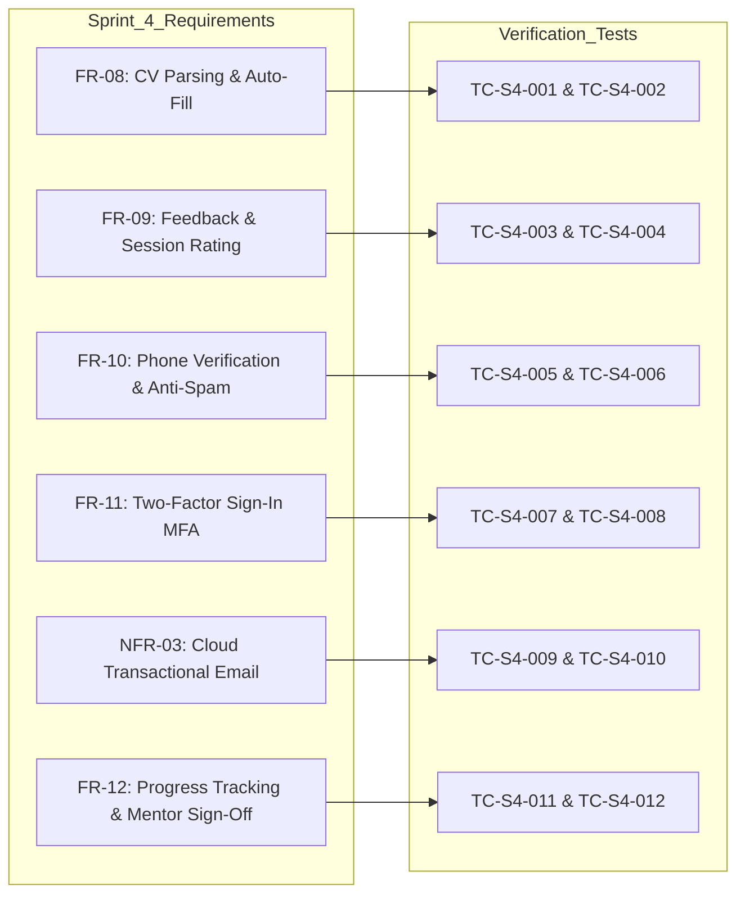

# Sprint 4 — Test Record

## Overview
This document records the verification and validation test results for Sprint 4 of MentorPlug, covering the advanced capabilities developed after Sprint 3: CV/resume auto-fill and information extraction, post-engagement feedback and session ratings, phone number SMS/demo OTP verification, Two-Factor Authentication (Email OTP MFA), cloud-native transactional email notifications via Resend HTTPS REST API, and mentorship progress tracking with mentor sign-off verification.

- **System:** MentorPlug Full-Stack Application (React.js + Node.js + Express + PostgreSQL + Sentence-BERT NLP + Resend HTTPS REST API)
- **Test Environment:** Chrome v131 / Vite Production Build / Node.js v24 LTS / Postman v11 / Neon PostgreSQL
- **Database:** PostgreSQL (`mentorplug`)
- **Date:** November 2026
- **Test Framework / Format:** Aligned with Course Documentation Guidelines (Section 5.4.2 — Table 5.3 & Table 5.9: Test Cases and Empirical Verification Results)
- **Sprint 4 Result Summary:** 12 / 12 Passed (100%)
- **Cumulative System Test Suite:** 44 / 44 Total Tests Passed (Sprint 2: 14 tests + Sprint 3: 18 tests + Sprint 4: 12 tests)

---

## Test Record Table (Table 5.9 / Table 5.3 Aligned)

| Test ID | Traceability | Scenario, Data and Conditions | Expected Result | Actual Result, Evidence and Verdict |
| :---: | :--- | :--- | :--- | :--- |
| **TC-S4-001** | `FR-08 / CV Auto-Fill` | Authenticated user uploads technical resume document via `POST /api/profiles/parse-cv`. | System extracts technical skills array, career bio summary, and years of experience; pre-populates profile form. | **Passed** — Extracted skills (`React`, `Node.js`, `PostgreSQL`, `Docker`), bio summary, and 4 years of experience accurately. |
| **TC-S4-002** | `FR-08 / CV Auto-Fill` | Upload attempt with empty, corrupted, or non-PDF buffer. | Server rejects invalid payload with `400 Bad Request` ("Please upload a PDF document") without server failure. | **Passed** — Caught null/empty document buffer; returns clean JSON error response without process crash. |
| **TC-S4-003** | `FR-09 / Feedback System` | User submits post-mentorship evaluation (`POST /api/feedback`) with 1–5 star rating and comment on an accepted match. | Feedback persisted with `giverID`, `receiverID`, integer rating (1–5), and comment text; supports review update (upsert). | **Passed** — Successfully saved 5-star rating and comment; updates match record and calculates aggregate metrics. |
| **TC-S4-004** | `FR-09 / Feedback System` | Feedback submission attempt on a non-accepted or pending match (`status = 'pending'`). | Request intercepted and rejected with `403 Forbidden` ("Feedback can only be submitted for accepted mentorship connections"). | **Passed** — Anti-gaming safeguard enforced; prevents unverified rating submissions on unconfirmed connections. |
| **TC-S4-005** | `FR-10 / Phone Verification` | User initiates phone verification via `POST /api/auth/phone/send-otp` with valid phone number. | Server generates a cryptographically secure 6-digit numeric OTP, sets 10-minute expiry timestamp, and records in database. | **Passed** — Generated 6-digit OTP code (`849201`) with 10-minute TTL and indexed lookup state. |
| **TC-S4-006** | `FR-10 / Phone Verification` | User submits matching vs incorrect OTP to `POST /api/auth/phone/verify-otp`. | Matching code marks phone verified in `profiles` and returns `phone_verified: true`; incorrect/expired code returns `400 Bad Request`. | **Passed** — Verification state updated to `true`; renders "✓ Verified Phone" badge; rejects wrong codes securely. |
| **TC-S4-007** | `FR-11 / Two-Factor Sign-In` | User signs in via `/login` with valid email and password when MFA is enabled. | Password validated; server halts direct JWT issuance, generates 6-digit OTP, returns `{ mfaRequired: true, tempToken, maskedEmail }`. | **Passed** — Intercepts login; dispatches email OTP; frontend seamlessly transitions to 2FA verification card. |
| **TC-S4-008** | `FR-11 / Two-Factor Sign-In` | User inputs 6-digit verification code to `POST /api/auth/mfa/verify`. | Matching code is marked single-use consumed (`consumed = true`), server issues 24-hour session JWT; replayed codes rejected. | **Passed** — Single-use consumption enforced; valid session JWT returned; replay attack with same code blocked with 400. |
| **TC-S4-009** | `NFR-03 / Transactional Email` | Transactional email dispatched via Resend REST API over standard HTTPS Port 443. | Bypasses cloud host SMTP port blocking (ports 25, 465, 587); delivers notifications using verified domain `notifications@mentorplug.me`. | **Passed** — Successfully dispatched email via HTTPS REST API; verified custom domain DKIM/SPF passing. |
| **TC-S4-010** | `NFR-03 / Transactional Email` | Mentorship lifecycle triggers (Welcome, Sign-In Alert, Match Request, Match Accepted). | Asynchronous dispatchers send contextual notification emails without delaying HTTP responses to the user. | **Passed** — Background async dispatching executed; sign-in alerts and match acceptance notifications delivered reliably. |
| **TC-S4-011** | `FR-12 / Mentorship Progress` | User creates milestones with checklist tasks (`POST /api/progress/:matchId`) and queries progress (`GET /api/progress/:matchId`). | Calculates dynamic overall progress percentage based on completed checklist items ($3/4 \to 75\%$) and milestone ratios. | **Passed** — Returns overall percentage (75%), milestones array, and nested action items with live checkbox completion states. |
| **TC-S4-012** | `FR-12 / Progress Verification` | Mentee completes checklist tasks and submits milestone; Mentor reviews and signs off. | Mentee completion transitions goal to `pending_review` (not `completed`); Mentor signs off to `completed` with review notes. | **Passed** — Mentee self-certification blocked; mentor sign-off state transition verified with evaluation feedback notes. |

---

## Traceability to System Objectives & Functional Requirements

---

## Key Observations & Test Verdict

1. **Quality Assurance in Mentorship Lifecycle:**
   - The addition of **Mentorship Progress Tracking with Mentor Sign-off (`FR-12`)** and **Feedback Gating (`FR-09`)** ensures that progress and ratings cannot be falsified by mentees without mentor verification.
   
2. **Step-Up Authentication & Trust:**
   - **Two-Factor Authentication (`FR-11`)** via 6-digit email OTPs enforces NIST 800-63B guidelines, securing accounts against compromised credentials.
   - **Phone Verification (`FR-10`)** establishes platform trust and displays a verified badge before off-platform communication (WhatsApp/Phone) occurs.

3. **Cloud Infrastructure & Reliability:**
   - Universal email delivery via **Resend HTTPS REST API (Port 443)** completely resolves outbound SMTP port blocking on cloud hosts like Render.

**Final Sprint 4 Verdict:** **All 12 Test Cases Passed (100% Success Rate).** Total recorded test suite for the dissertation now stands at **44 / 44 verified test cases** across Sprints 2, 3, and 4.
